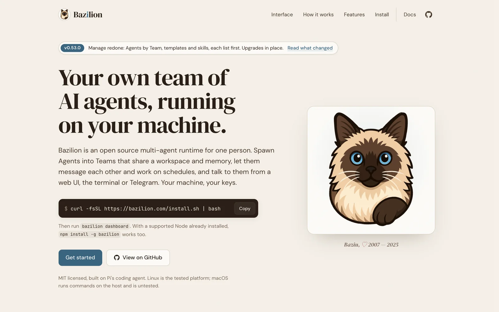

# bazilion-web

The source of [bazilion.com](https://bazilion.com): the homepage and the documentation of
[Bazilion](https://github.com/rullopat/bazilion), a local-first multi-agent runtime that runs your
own team of AI agents on your machine.

[](https://bazilion.com)

## What is here

| Path | What it is | Served at |
| --- | --- | --- |
| `src/pages/index.astro`, `src/styles/global.css` | The homepage: one Astro page and its styles | [`/`](https://bazilion.com) |
| `src/content/docs/docs/` | The guides, built with [Starlight](https://starlight.astro.build); styles in `src/styles/docs.css` | [`/docs/`](https://bazilion.com/docs/) |
| `src/content/docs/docs/whats-new.md` | One rolling page with the latest four releases, newest first | [`/docs/whats-new/`](https://bazilion.com/docs/whats-new/) |
| `public/install.sh` | The installer for Linux and macOS | [`/install.sh`](https://bazilion.com/install.sh) |
| `public/screenshots/` | Pictures of the web UI used by the homepage and the guides | `/screenshots/` |
| generated | The guides as plain text for LLMs, by `starlight-llms-txt` | [`/llms.txt`](https://bazilion.com/llms.txt) |
| `skills/` | Agent skills for working on this site, such as updating it for a release | |
| `scripts/` | The policy tests and the docs check that every build runs | |

## Develop

Needs Node.js 22.12 or later and pnpm.

```sh
pnpm install
pnpm dev          # the site with live reload, on http://localhost:4321
pnpm check:docs   # policy tests, the build, then links, anchors and release references
pnpm preview      # serve the built site from dist/
```

`pnpm build` and `pnpm check:docs` run the same steps: the build fails when a link, an anchor or a
release reference is wrong.

## Deploy

[Cloudflare Workers Builds](https://developers.cloudflare.com/workers/ci-cd/builds/) builds every
push and publishes `main` as an assets-only Worker (`wrangler.jsonc`); there is no deploy script.
A pull request gets a build check, and merging it publishes the site about a minute later.

## Writing for the site

- The site describes released Bazilion versions only: commands and flags as the released CLI's
  `--help` gives them, environment variables as the released code reads them.
- The homepage never states the version of Pi, the engine Bazilion is built on; the guides and
  release notes may.
- A release updates What's new and the current-release references together:
  `skills/release-notes/SKILL.md` walks through it.
- Check visual changes at desktop and phone widths.

[AGENTS.md](AGENTS.md) has the full guidelines.
